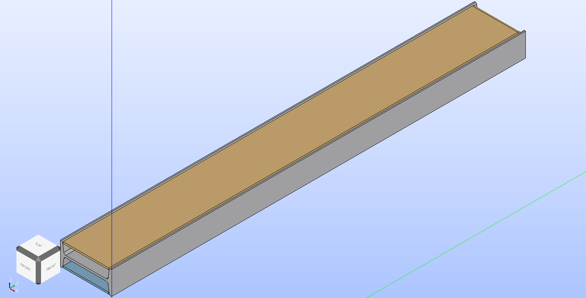
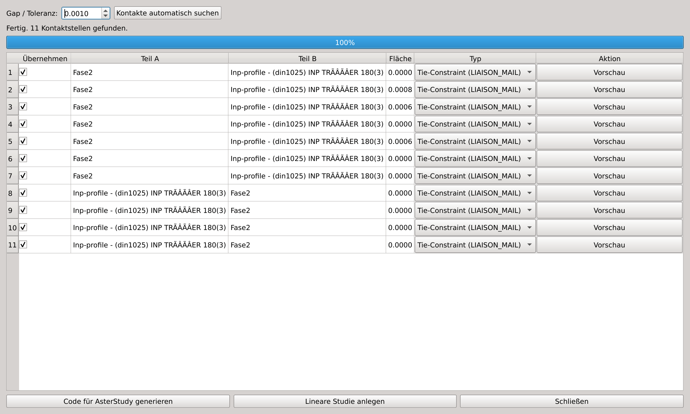
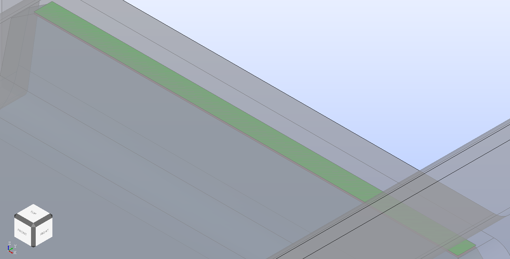
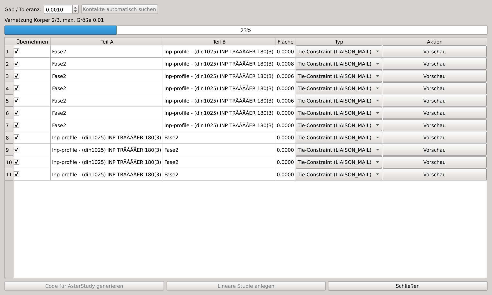
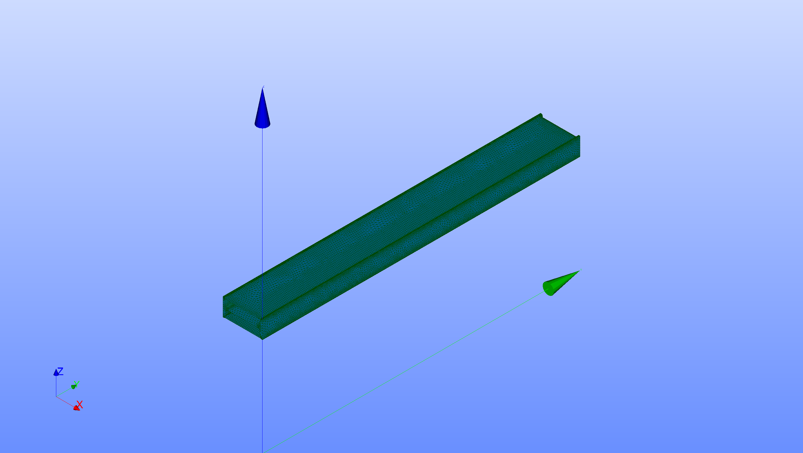
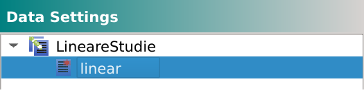
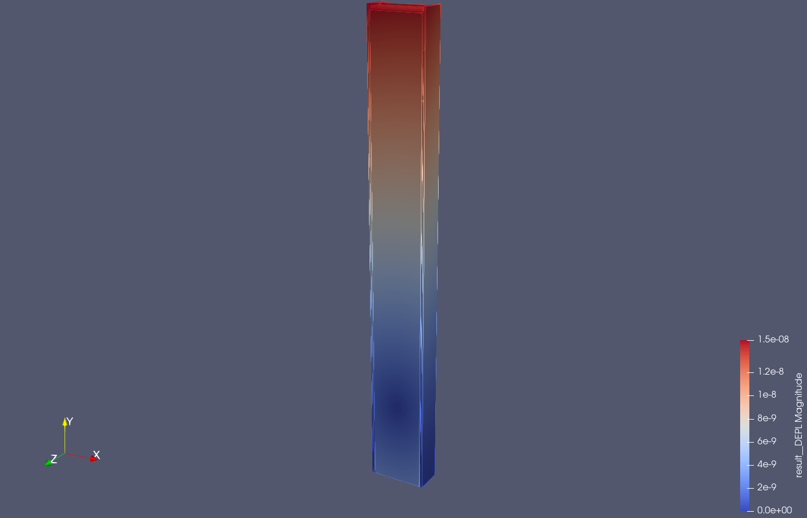
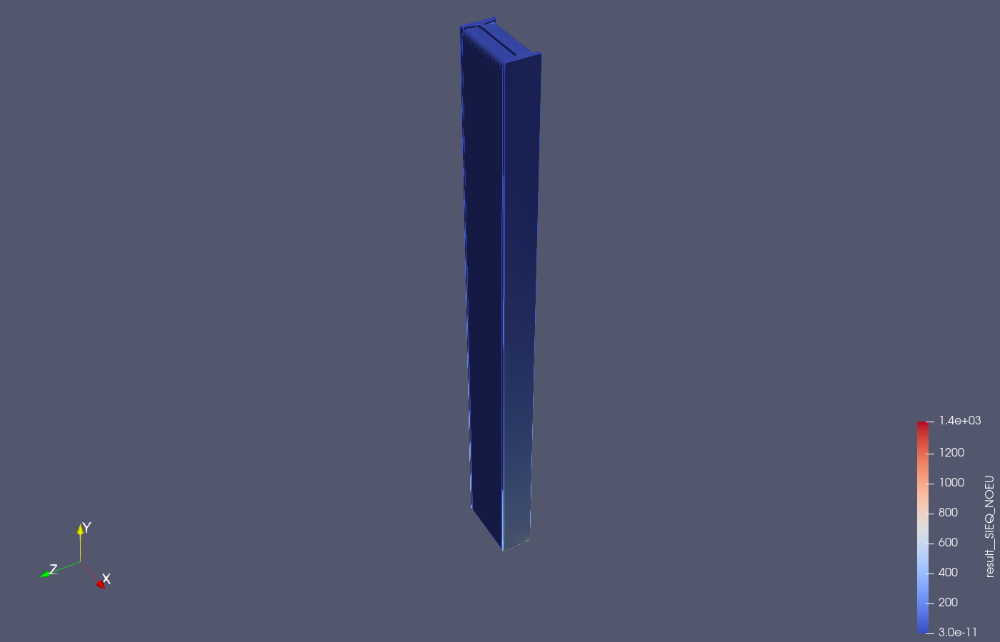

# Salome-Meca Contact Wizard

**Version 0.0.3**

A graphical wizard for Salome-Meca that automatically detects contacts between volume bodies and generates ready-to-use Code_Aster commands (`LIAISON_MAIL` for ties and `DEFI_CONTACT` for contacts).

Based on the original `3DContact.py` script by Lucio Gomez (psicofil).

## Features

- Automatic contact detection between selected solids using `geompy.FastIntersect`
- Every contact site between two bodies, not only the first
- A progress bar during the search
- Interactive table listing all contact pairs
- Preview of the two bodies at half transparency, with the first body's patch in red and the second body's patch in green, zoomed onto the contact
- The contact patch is the common overlap within the gap tolerance: parallel faces, planar faces up to 10 degrees apart, and a curved band
- Per-contact type selection via dropdown:
  - Tie-Constraint (`LIAISON_MAIL`)
  - Contact (`DEFI_CONTACT` CONTINUE)
  - Contact with Friction
  - Ignore
- Generates a Code_Aster snippet that can be pasted into AsterStudy
- **Lineare Studie anlegen** builds a runnable linear static AsterStudy case from the selected tie rows
- Creates geometry groups automatically

## Requirements

- Salome-Meca (tested with recent versions)
- Python with PyQt5 (included in Salome)

## Installation & Usage

1. Clone or download this repository.
2. Open Salome-Meca and switch to the **Geometry** module.
3. Select the volume bodies between which you want to detect contacts (or leave none selected to try all solids).
4. The geometry must already contain groups named exactly `fixed` and `load`. Without them the wizard stops and asks for those groups.
5. Go to `File → Load Script...` and select `contact_wizard.py`.
6. Adjust the gap tolerance if needed and click **"Kontakte automatisch suchen"**.
7. Review the list and choose the connection type for each contact pair. The column **Übernehmen** marks the rows for the linear study.
8. Click **"Code für AsterStudy generieren"** to write `aster_contacts.comm` in the current directory.
9. Copy the generated code into your AsterStudy case (into `AFFE_CHAR_MECA` for ties and/or as a `DEFI_CONTACT` definition).

For a complete linear case, tick the tie rows and click **"Lineare Studie anlegen"**. The button meshes every loaded solid, creates the case `LineareStudie`, and leaves it ready to run. It does not start the calculation and it does not save the study. Loads, boundary conditions and contact sets are three separate `AFFE_CHAR_MECA` commands.

The linear case uses:

- a first-order tetrahedron mesh, maximum size 0.01, one mesh per solid, concatenated without merging nodes
- steel, `E = 2.1e11`, `NU = 0.3`
- `DDL_IMPO` on group `fixed` with `DX = DY = DZ = 0`
- `FORCE_FACE` on group `load` with `FX = 1`
- one `LIAISON_MAIL` factor per ticked tie pair, in its own `AFFE_CHAR_MECA`: slave groups are the contact patches, the master is the volume group `VOL_<i>` of the second body, `DISTANCE_MAX` is the gap tolerance
- MED output of displacements and von Mises stress (`SIEQ_NOEU`, component `VMIS`)
- 4096 MB and a time limit of 1800 s

The mesh is referenced as the live SMESH object. The result file is `linear_study/result.med` next to the opened study. A patch that does not produce a mesh group is left out and named in the dialog. On `test.hdf` at gap 0.02 that happens for `CONT_0_1_11` and `CONT_8_9_1`.

The first time AsterStudy opens, Salome may ask for the code_aster version.

## Guided example

`assembly1.hdf` is a small assembly: two `Fase2` solids and an INP 180 beam. The geometry groups `fixed` and `load` are already on the beam. `fixed` is the beam end, `load` is a long side face. The figures below are from one complete run with the default gap of 0.001 m.

The search finds 11 contact sites, all between a `Fase2` solid and the beam. All 11 stay in the linear case as tie constraints. The joined mesh has 77881 nodes. With `FX = 1` on `load`, the displacement magnitude reaches about `1.48e-8` m and the von Mises stress peaks at about 1412 Pa.

### Open the study

Start Salome-Meca and open `assembly1.hdf` with `File → Open`. Activate the Geometry module. The Object Browser lists the compound, the three solids, and the groups `fixed` and `load` under the beam. Display the three solids and fit the view.



The figure colors the two `Fase2` solids and the beam separately, so the three bodies can be told apart.

### Run the contact wizard

Select the three solids in the Object Browser. Leave the compound and the groups `fixed` and `load` unselected. Choose `File → Load Script...` and open `contact_wizard.py`.

Keep the gap at 0.001 and click **Kontakte automatisch suchen**. The status line reports 11 sites. Every row is checked in **Übernehmen**, and the type is **Tie-Constraint (LIAISON_MAIL)**.



### Preview one contact

Click **Vorschau** on a row. The figure uses row 2, the largest patch in this study (about `8.3e-4` m²). The view zooms onto that patch. Both bodies are drawn half transparent. The patch on the first body is red and the patch on the second body is green.



### Mesh the assembly

Leave the tie rows checked and click **Lineare Studie anlegen**. The wizard meshes one solid at a time with first-order tetrahedra and a maximum size of 0.01. The progress line names the body it is meshing.



`fixed` and `load` are copied onto the mesh of the beam, the solid that owns those geometry groups. Each kept contact becomes a pair of face groups. The three meshes are joined without merging nodes. The result in the Object Browser is the mesh `linear_assembly`.



### Run the analysis

The same button opens AsterStudy and creates the case `LineareStudie`. It does not start the calculation. A dialog names the case, the mesh, and the result file `linear_study/result.med` next to the study. The case uses 4096 MB and a time limit of 1800 s.



In the AsterStudy history, run `LineareStudie`. The stage solves a linear static problem: steel, `E = 2.1e11` and `NU = 0.3`, the pressure `FX = 1` on `load`, a fixed support on `fixed`, and one `LIAISON_MAIL` factor for each pair of bodies. On this assembly Code_Aster reports a distance alarm for `LIAISON_MAIL`, because a few slave nodes lie outside the default alarm distance. The calculation still finishes and writes `linear_study/result.med`.

### Plot displacement and von Mises stress

Open `linear_study/result.med` in ParaVis. Show the surface. Color it by the point field `result__DEPL`, component **Magnitude**.



The supported end stays at zero. The magnitude grows toward the free end and reaches about `1.48e-8` m.

Color the same surface by `result__SIEQ_NOEU`, component **VMIS**.



The von Mises stress peaks at about 1412 Pa. On the full data range most of the beam stays at the bottom of the scale, because that peak is local.

## Generated Groups

The script creates one face group per contact site, named `CONT_<i>_<j>_<n>_A` and `CONT_<i>_<j>_<n>_B` (`n` counts the sites between the same two solids). Tie masters in the generated code are volume groups `VOL_<i>`, where `i` is the index of the second body in the loaded solid list. `fixed` and `load` are existing geometry groups. The linear-study button transfers them onto the mesh itself.

## Tests

`test.hdf` is the geometry fixture: 11 solids and the groups `fixed` and `load`. The tests open a copy of that file and exit Salome with `SystemExit`. They do not save `test.hdf`.

Run them from the repository root. `SALOME_MECA` may point at another starter. The command `salome` on `PATH` does not forward arguments in this environment.

```bash
testing/run_salome_test.sh contact_preview_test.py
testing/run_salome_test.sh static_analysis_test.py
testing/run_salome_test.sh linear_study_test.py
```

| Script | What it checks |
| --- | --- |
| `testing/contact_preview_test.py` | Contact search at gap 0.001 and one screenshot per site in `testing/screenshots/contact_XX.png` |
| `testing/static_analysis_test.py` | Search at gap 0.02, connectivity, tetra mesh, a code_aster solve, `displacement.png` and `von_mises.png` |
| `testing/linear_study_test.py` | The linear-study button: missing `fixed`/`load`, empty selection, then the AsterStudy case |
| `testing/shot_results.py` | Redraw the two result screenshots from an existing MED file (`CONTACT_RESULT_MED`, default `/tmp/contact_static/result.med`) |

On this fixture the gap-0.02 search finds 64 sites. The linear case keeps 62 of them and builds a mesh of 134076 nodes and 436199 tetrahedra. Reference pictures in `testing/screenshots/` are from an earlier solve of the 54-tie model: the displacement magnitude runs up to about `3.24e-8` m and the von Mises stress peaks near 2154 Pa. Logs and the calculation files stay under `/tmp`.

## License

GPL-3.0 (see LICENSE file). Original contact detection logic inspired by Lucio Gomez' script (LGPL).

## Credits

- Original contact detection concept: Lucio Gomez (psicofil)
- Wizard and Code_Aster integration: developed with Grok
